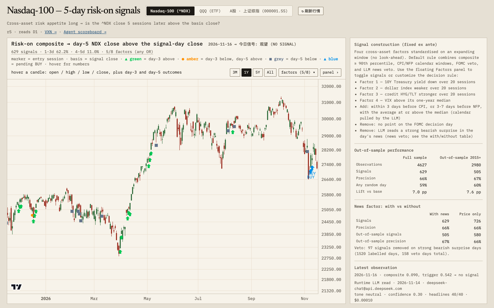
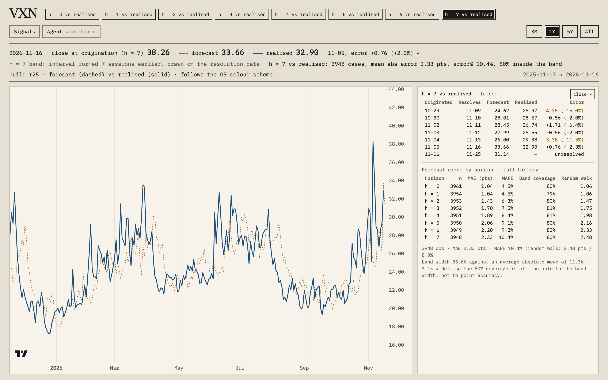
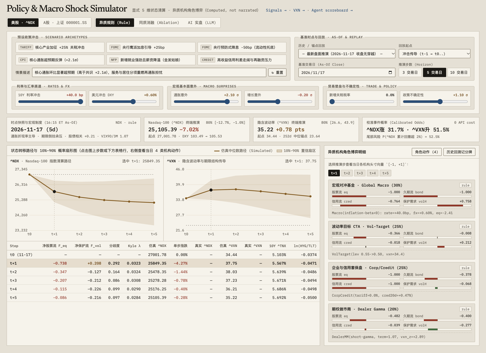

# forecast-log

Point-in-time market forecasting, cross-asset signal validation, gated LLM agent evaluation, and multi-agent policy simulation—built with strict anti-leakage cutoffs (`as_of`) so every probability and signal is scored against out-of-sample reality.

## Quick Start

```bash
make            # Creates .venv, downloads data/forecast.db, starts http://127.0.0.1:8731/
```

`data/forecast.db` is published as an overwritten release asset on [`data-latest`](https://github.com/abenoharukas/forecast-log/releases/tag/data-latest) (never committed to git history) and ships pre-populated with 15 market series, 3 signal markets, historical news, and multi-model evaluation runs.

| Command | Description |
|---|---|
| `make` / `make dev` | Start local dashboard server on port `8731` (`make dev PORT=9000` to override) |
| `make data` / `make data-refresh` | Download `data/forecast.db` if missing / force latest snapshot |
| `make refresh` | Incrementally fetch latest Yahoo Finance bars across all 15 symbols and recompute signals |
| `make test` | Run the offline test suite (`pytest -q`, no network or API keys needed) |
| `make cf` / `make worker` | Deploy static assets + Worker + incremental D1 sync to Cloudflare / run local Worker on `8787` (`RESEED=1 make cf` reloads D1 from the local DB) |
| `make status` / `make stop` | Check or stop the process listening on `PORT` |

## Pages & Features

### 1. Cross-Asset Risk-On Signals (`/`, `/ndx`, `/qqq`, `/a-shares`)

Evaluates 5-session upside calls across Nasdaq-100 (`^NDX`), tradable Invesco QQQ (`QQQ`), and next-day Shanghai Composite (`000001.SS`) on a unified candlestick view (`web/points.html`, `cross.py`, `china.py`).



- **Method**: Combines an expanding-window 4-factor composite (`^TNX` 20d yield drop, `DX-Y.NYB` 20d weakening, `HYG/TLT` credit appetite, `^VIX` vs. 1y median) with `CPI`/`NFP` pre-release windows and an `FOMC` decision-day veto, logging signal `base_close` separately from next-open `entry`.
- **Controls**: Switch markets, toggle bit-packed factors and boolean rules (`OR`, `>= 2`, `AND`, veto tolerance, LLM news vetoes) in the floating `factors ▾` panel (`ctxbar.js`), or open the side-panel **DeepSeek × Qwen** group chat (`group_chat.py`) to debate `BUY` / `SELL` / `HOLD`.
- **Benchmark**: Out-of-sample (2015+) 5-day precision reaches `67%` on `^NDX` (`+7.6 pp` over base rate), `+7.8 pp` on unadjusted `QQQ`, and `59.9%` (`+6.8 pp`) on `000001.SS`.

### 2. `VXN` Volatility Analogue Intervals (`/vxn`)

Plots non-parametric historical analogue forecasts and conditional 10%–90% intervals for CBOE NASDAQ-100 Volatility (`^VXN`) across horizons `h = 0..7` trading sessions (`web/index.html`, `estimate.py`, `backtest.py`).



- **Method**: Matches each session strictly within past history on standardized 5/21/252-day returns, distance to the 252-day median, CBOE term structure (`^VIX9D / ^VIX3M`), and vol-of-vol (`^VVIX`), aligning every `h`-step forecast on its target resolution date rather than origination date.
- **Controls**: Step through horizons `h = 0` to `h = 7`, switch lookback windows (`3M`, `1Y`, `5Y`, `All`), and inspect resolved vs. pending calls in the side-by-side horizon error ledger.
- **Benchmark**: Conditional 10%–90% bands maintain `80%` empirical coverage across ~3,950 sessions and separate next-day tail-move regimes (`8.6% -> 13.0% -> 28.4%` across narrow / medium / wide bands), whereas point medians barely edge a random walk (`8.5%` vs. `8.9%` at `h = 7`).

### 3. Gated Research Agent & Scoreboard (`/agent`)

Benchmarks tool-using LLM forecasters and statistical baselines under a hard point-in-time anti-leakage gate (`web/agent.html`, `src/forecast_log/agent/`).


- **Method**: Runs an 8-step agent loop over 7 `AsOf`-gated tools (`price_history`, `series_stats`, `base_rate`, `analogue_forecast`, `search_news`, `read_doc`, `market_implied`) where any post-cutoff access raises `LookAheadError`, pooling multi-run probabilities in log-odds space.
- **Controls**: Toggle `DeepSeek` (`deepseek-chat`, `deepseek-flash`, `deepseek-v4-pro`, plus `blind` no-tool ablation) and `Qwen` (`qwen3.8-flash`) suites, and filter the per-question exam paper by `Actual` historical outcome vs. `AI result` (`✓`, `~`, `✗`).
- **Benchmark**: On shared questions (`n = 74`), `deepseek-chat` with gated tools (`Brier 0.1830`, `ECE 0.037`) matches the statistical analogue (`0.1830`) and beats its own tool-removed `blind` run (`0.2273`), confirming forecasting skill comes from gated evidence retrieval rather than model priors.

### 4. Multi-Agent Policy & Macro Shock Simulator (`/sim`)

Simulates cross-asset shock transmission across US (`^NDX` / `^VXN`) and China A-share (`000001.SS` / `RV20`) markets via explicit 5-state clearing equations (`web/sim.html`, `sim.py`).



- **Method**: Four heterogeneous institutional mandates submit bounded order flows (`[-1, +1]`, never target prices) into a 5-state clearing engine featuring endogenous Kyle's $\lambda$ liquidity, regime-switching stock-yield sensitivity, and Ornstein-Uhlenbeck volatility relaxation, gated at `16:15 ET` (US) and `15:05 CST` (A-shares).
- **Controls**: Switch `^NDX` and `000001.SS`, select date-agnostic policy archetypes or adjust 6 macro shock sliders, compare `rule` / `homogeneous` ablation / live `llm` (`DeepSeek × Qwen`) actor backends, and replay relative anchors or 252-day historical extremes over `3` / `5` / `10` sessions.
- **Benchmark**: Across `488` macro events (`FOMC`, `CPI`, `NFP`), heterogeneous mandates lift event-day directional hit rate to `57.4%` (vs. `54.7%` homogeneous) and calibrate 5-day volatility propagation (`Brier 0.2467–0.2483`, `ECE <= 0.010`), while unshocked 5-day equity drift remains near coin-flip (`Brier 0.2506`).

## Storage & Architecture

`data/forecast.db` uses **5 flat SQLite tables** in WAL mode without foreign keys or redundant OHLCV copies (`src/forecast_log/db.py`):

| Table | Primary Key | Role |
|---|---|---|
| `bars` | `(symbol, date)` | Daily `open, high, low, close, volume`, settlement flag `is_closed` (`16:15 ET` / `15:05 CST`), and `fetched_at` across 15 symbols. |
| `signals` | `(market, date)` | Signal basis, tradable `entry`, 3d/5d outcomes, composite scores, and 4-bit `factors_packed` masks for `ndx`, `qqq`, and `ssec` (`LEFT JOIN bars` on read). |
| `news` | `(as_of, doc_id)` | Time-gated historical Wikipedia `Portal:Current events` corpus (`127k+` items) and daily GDELT / WSJ / Fed / SEC RSS fetches. |
| `agent_eval` | `(dataset, question_id, predictor)` | Per-question benchmark probabilities, Brier inputs, USD cost, latency, tool calls, and gate violations. |
| `chat_messages` | `(thread_id, seq)` | Persistent market context snapshots, user prompts, and multi-round `DeepSeek × Qwen` stance transcripts. |

- **On-Demand Intraday Refresh (`server.py`, `yahoo.py`)**: `POST /api/refresh` re-fetches overdue unclosed bars (`is_closed = 0` past local market close) immediately and throttles active intraday refreshes to a 5-minute cooldown.
- **Immutable Locks & Daily News (`commands.py`, `daily.py`)**: `forecast-log lock` writes append-only ex-ante probabilities (`forecasts/<id>.json`) settled later by `resolve` and `score`; `daily` classifies post-close RSS/GDELT headlines without overriding price rules.

## CLI & Companion Docs

```bash
python3 -m venv .venv && source .venv/bin/activate
pip install -e ".[dev]"
cp .env.example .env    # Configure DEEPSEEK_API_KEY and optional QWEN_API_KEY
```

| Command | Description |
|---|---|
| `forecast-log serve [port]` | Start the local HTTP server (default `8731`) |
| `forecast-log fetch` / `cross` / `backtest` | Fetch incremental OHLCV, recompute cross-asset signals, or run walk-forward `VXN` backtests |
| `forecast-log lock` / `resolve` / `score` | Lock ex-ante probabilities for `questions.json`, settle outcomes after close, and compute Brier scores |
| `forecast-log daily` / `news-backfill` | Ingest time-gated daily RSS/GDELT headlines with LLM tone read, or backfill Wikipedia historical news |
| `forecast-log news-ab` / `news-veto` | Run DeepSeek vs. Qwen news labeling A/B tests and bearish-veto backtests |
| `forecast-log agent-forecast` / `agent-eval` | Produce pooled shadow forecasts or run shared-intersection historical benchmarks (`agent-report` to format) |
| `forecast-log sim` / `sim-backtest` | Run single policy shock scenarios (`rule` / `homogeneous` / `llm`) or multi-event historical shock backtests |

Detailed notes: [`SUBMISSION.md`](SUBMISSION.md) (executive benchmark brief) · [`docs/agent.md`](docs/agent.md) (agent & anti-leakage design) · [`docs/sim.md`](docs/sim.md) (policy simulator math & backtests) · [`docs/news_ab.md`](docs/news_ab.md) (multi-model news A/B) · [`arch.md`](arch.md) (Cloudflare D1 architecture & commands) · [`deploy/README.md`](deploy/README.md) (Cloudflare Workers + D1).
