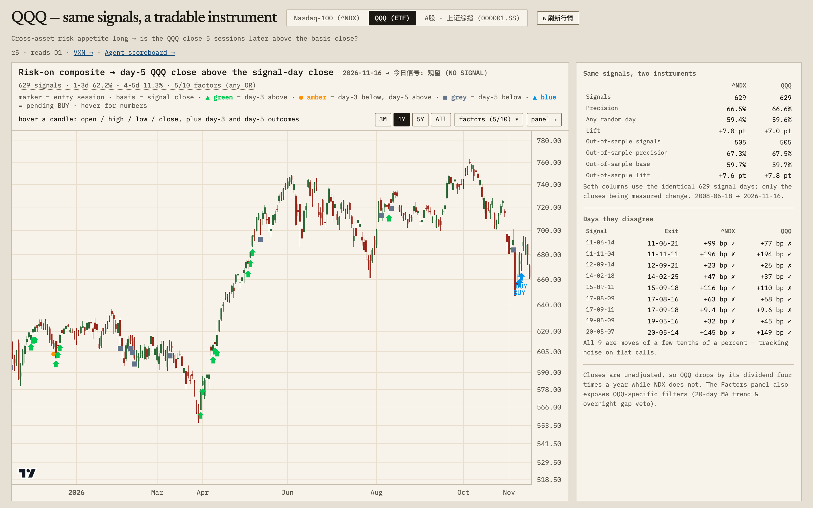
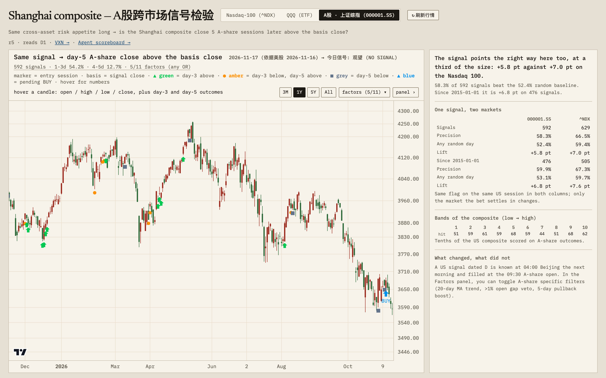
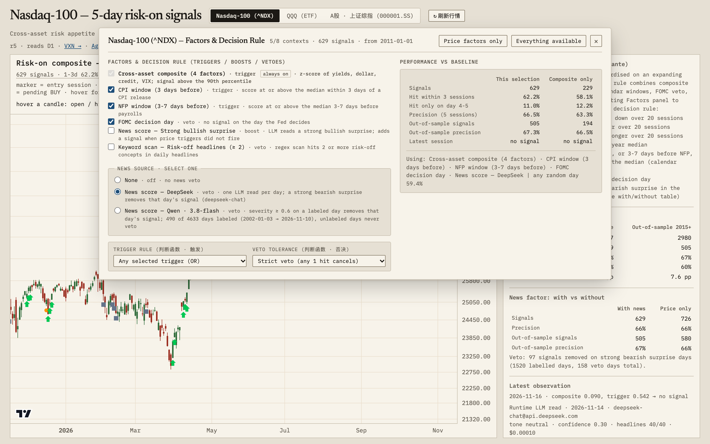
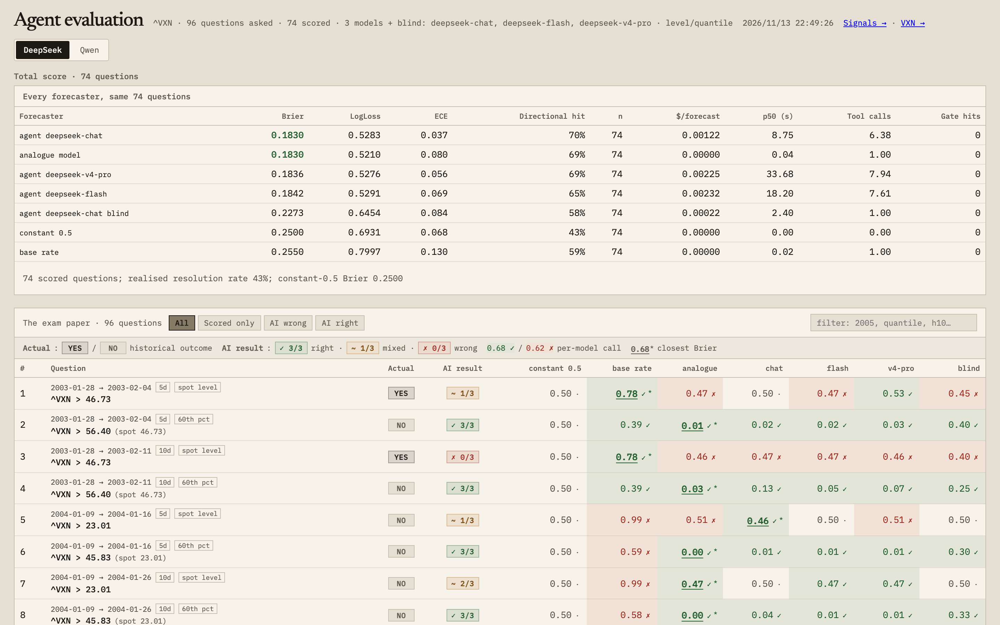

# forecast-log

**A point-in-time market forecasting, cross-asset signal validation, and agent evaluation system that locks probabilities before outcomes are knowable, prevents look-ahead leakage by construction, and scores every call against reality.**

> For a short executive engineering note on the agent benchmark, see [`SUBMISSION.md`](SUBMISSION.md).


## Quick Start

`data/forecast.db` is tracked with Git LFS and ships pre-populated with 15 market series (`107,574` daily bars), 3 cross-asset signal markets, `127,845` historical headlines, and multi-model agent evaluation runs—so the entire dashboard runs out of the box after cloning:

```bash
git lfs pull    # Pull data/forecast.db if Git LFS did not smudge on clone
make            # Creates .venv, installs dependencies, and starts http://127.0.0.1:8731/
```

Common `Makefile` targets:

| Command | Description |
|---|---|
| `make` / `make dev` | Start the local no-cache dashboard server on port `8731` (override via `make dev PORT=9000`) |
| `make refresh` | Force an immediate incremental Yahoo Finance OHLCV fetch across all 15 symbols and recompute signals (`POST /api/refresh?force=1`) |
| `make test` | Run the offline test suite (`pytest -q`, zero network calls or API keys required) |
| `make status` / `make stop` | Check or stop the process listening on `PORT` |
| `make cf` | Build static assets, provision/reuse Cloudflare D1, deploy the Worker, and incrementally sync local data |
| `make worker` | Run the Cloudflare Worker and local D1 database locally on port `8787` via `wrangler dev` |

## Core Features & Live Views

### 1. Multi-Market Cross-Asset Risk-On Dashboard (`/ndx`, `/qqq`, `/a-shares`)

`web/points.html` unifies three equity markets into a single logarithmic candlestick K-line view with market-specific up/down color conventions (green-up / red-down for US indices; red-up / green-down for Chinese A-shares):

- **Ex-ante 4-Factor Risk-On Composite (`src/forecast_log/cross.py`)**: Standardizes four cross-asset legs on a strictly recursive expanding window (using data up to session $t$ only):
  1. **10-Year US Treasury Yield (`^TNX`)** — 20-session yield decline (lower discount rate).
  2. **US Dollar Index (`DX-Y.NYB`)** — 20-session dollar weakening (easier global liquidity).
  3. **Credit Appetite Ratio (`HYG / TLT`)** — 20-session outperformance of high-yield corporate bonds over 20+ year Treasuries.
  4. **Implied Volatility Level (`^VIX`)** — elevation relative to its trailing 1-year median.
- **Macro Event Calendar Rules (`src/forecast_log/events.py`)**: Combines the 90th-percentile composite trigger with pre-release windows (`<= 3` days before **CPI** or `3–7` days before **NFP** when composite `>=` median) and a hard **FOMC** decision-day veto.
- **Strict Separation of Signal Basis (`base_close`) vs. Tradable Fill (`entry`)**: Every call tests whether the close 5 trading sessions later (`close5`) exceeds `base_close` (the close on which the call is evaluated), while separately logging `entry` (the next session's open price, capturing overnight gap slippage).
- **Outcome Markers & Live Crosshair Readout**:
  - `▲ green` — fast hit (`close3 > base_close` and `close5 > base_close`)
  - `● amber` — late hit (`close3 <= base_close`, `close5 > base_close`)
  - `■ grey` — miss (`close5 <= base_close`)
  - `▲ blue (BUY)` — active signal within the 5-session settlement window

#### Tradable ETF Verification (`/qqq`)

To verify that index-level alpha survives real ETF tracking and quarterly dividend drops (unadjusted closes), `/qqq` evaluates the exact same 629 US signal dates on **Invesco QQQ Trust (`QQQ`)**. Full-sample lift holds at **`+7.0 pp`** (`+7.8 pp` out-of-sample since 2015), with only 9 flat-call disagreements (`1.4%`) across 18 years:



#### Cross-Market Signal Transmission to Chinese A-Shares (`/a-shares`)

Because US session $D$ closes at `04:00` Beijing time on $D+1$—well before the `09:30` Shanghai open—`src/forecast_log/china.py` maps the unmodified US signal onto the first subsequent **Shanghai Composite Index (`000001.SS`)** session. Post-2015 out-of-sample precision reaches **`59.9%`** against a `53.1%` random-day baseline (**`+6.8 pp`** lift across 476 signals):



### 2. Interactive Model Context Factors & Rule Switchboard

Clicking **`factors ▾`** (or the rule summary bar) opens the floating **Model Context Factors** switchboard (`web/ctxbar.js`), allowing live, zero-latency experimentation directly in the browser:



- **Bit-Packed Factor Matrix (`factors_packed`)**: Every trigger, boost, trend filter, overnight gap filter, regex keyword scan, and LLM news label is packed into 4-bit slots per trading day in SQLite (`signals.factors_packed`) and unpacked client-side.
- **Configurable Boolean Decision Functions**: Instead of hardcoding a single rule, users can switch:
  - **Trigger rule**: `Any selected trigger (OR)` · `Multi-factor consensus (>= 2)` · `All selected triggers (AND)`
  - **Veto tolerance**: `Strict veto (any 1 hit cancels)` · `Double-confirm veto (>= 2 hits)`
- **Per-Market Filter & LLM News Veto Controls**: Remembers selections independently for `^NDX`, `QQQ`, and `000001.SS`, exposing index-specific filters (`Below 20-day MA`, `Overnight gap > +1.5%` / `+1.0%`, `A-share 5-day pullback < -3%`) and mutually exclusive LLM news veto sources (`None`, `DeepSeek`, `Qwen 3.8-flash`), recomputing full-sample precision, 3-day fast-hit rate, 2015+ out-of-sample precision, and today's live call instantaneously.

### 3. `VXN` Multi-Horizon Volatility Analogue Intervals (`/vxn`)

`web/index.html` evaluates non-parametric historical analogue forecasts (`src/forecast_log/estimate.py`, `backtest.py`) for **`^VXN`** (CBOE NASDAQ-100 Volatility Index) across horizons **`h = 0` (same day) through `h = 7` (7 trading sessions ahead)**:


- **State-Space Matching**: Matches each session against historical neighbours on standardized 5-, 21-, and 252-day returns, deviation from the 252-day median, CBOE volatility term structure (`^VIX9D / ^VIX3M`), and vol-of-vol (`^VVIX`).
- **Resolution-Date Alignment**: Plotting a 7-day forecast on its origination date makes any high-autocorrelation series look artificially accurate; `/vxn` plots every `h`-step forecast (dashed ochre) directly on its target resolution date against the realised close (solid blue).
- **Honest Error Ledger**: Displays the latest resolved and pending calls alongside full-history metrics (~3,950 sessions per horizon). While point forecasts barely beat a random walk (`8.5%` vs. `8.9%` median 7-day error), **conditional 10%–90% interval width** achieves `80%` empirical coverage and cleanly separates quiet vs. turbulent regimes (next-day `|return| > 8%` probability rises from `8.6% -> 13.0% -> 28.4%` across narrow / medium / wide 1-day bands).

### 4. Point-in-Time Gated Research Agent & Multi-Model Scoreboard (`/agent`)

`src/forecast_log/agent/` implements a framework-free, tool-using forecasting agent and multi-model evaluation harness (`web/agent.html`):



- **Hard Anti-Leakage Gate (`agent/gate.py`)**: Every tool output, news `published_at` timestamp, and cited evidence date passes through `AsOf.check()`. Touching post-cutoff data raises `LookAheadError` immediately rather than silently clipping rows, rejecting the submission and logging the violation in `Trace.rejections`.
- **7 Gated Tools & 8-Step Loop (`agent/tools.py`, `agent/loop.py`, `agent/llm.py`)**: Uses ~120 lines of stdlib `urllib` against any OpenAI-compatible `/chat/completions` endpoint (DeepSeek, Qwen, OpenAI, OpenRouter, vLLM, Ollama), including full support for reasoning-model `reasoning_content` round-tripping. Tools cover `price_history`, `series_stats`, `base_rate`, `analogue_forecast` (demoting the repo's statistical model to one advisory input), `search_news`, `read_doc`, and `market_implied`.
- **Log-Odds Ensemble Pooling (`agent/ensemble.py`)**: Pools $N$ independent agent runs symmetrically in log-odds space and reports logit `spread` to quantify model self-disagreement.
- **Shared-Intersection Multi-Model Scoreboard (`agent/eval.py`, `web/agent.html`)**: Compares **DeepSeek** (`deepseek-chat`, `deepseek-flash`, `deepseek-v4-pro`, plus tool-removed `blind` ablation) and **Qwen** (`qwen3.8-flash`) strictly on the shared intersection of answered questions (`scored_on_shared`). **The exam paper** table separates historical reality (`Actual`: `YES`/`NO`) from aggregated model directional accuracy (`AI result`: `✓ 3/3`, `~ 1/3`, `✗ 0/3`) with interactive outcome filters and search.

### 5. Immutable Forecast Locks & Daily Post-Close News Pipeline

- **Ex-Ante Lock / Resolve / Score (`questions.json`, `forecasts/`, `resolutions.json`)**: Questions, Yahoo Finance data sources, and settlement sessions are frozen ahead of time. `forecast-log lock` writes append-only probability and evidence files once (refusing to overwrite existing locks); `resolve` and `score` settle outcomes after market close and compute Brier scores.
- **Daily Runtime News Tagger (`forecast-log daily`)**: Pulls GDELT and three RSS feeds (WSJ Markets, Federal Reserve monetary policy statements, SEC press releases), enforces `published_at <= as_of`, runs a 24-concept regex keyword scan (`keywords.py`), and prompts an LLM for a structured risk-tone read (`risk-on` / `neutral` / `risk-off` + top drivers) archived in `artifacts/daily/<YYYY-MM-DD>.json` (~`$0.0003` per run). High-confidence `risk-off` reads during active price signals are flagged as `contested` on the dashboard without silently overriding price rules.
- **Historical News Corpus & Multi-Model A/B Testing (`wiki_news.py`, `news_ab.py`, `news_veto.py`)**: Backfills `127,845` time-gated headlines across `6,078` trading days (2002–2026) from Wikipedia `Portal:Current events` into SQLite and measures inter-model agreement (DeepSeek vs. Qwen Cohen's $\kappa = 0.479$, severity Spearman $\rho = 0.770$; see [`docs/news_ab.md`](docs/news_ab.md)).

## Architecture & 4-Table SQLite Design

### System Data Flow

```text
Yahoo Finance OHLCV (15 symbols)      Wikipedia Current Events + GDELT / WSJ / Fed / SEC RSS
              │                                                   │
              ▼ (incremental, is_closed aware)                    ▼ (published_at <= as_of gate)
    ┌───────────────────┐                               ┌───────────────────┐
    │   SQLite: bars    │◄────────── LEFT JOIN ─────────│  SQLite: signals  │◄── cross.py / china.py
    └─────────┬─────────┘                               └─────────┬─────────┘    + events.json + LLM labels
              │                                                   │
              ├──► Vectorized AnalogModel (load_timeline)         ├──► /api/cross/{ndx,qqq,ssec}
              │    + fingerprint memory cache ──► /api/timeline   │    ──► web/points.html + ctxbar.js
              │                                                   │
              ▼                                                   ▼
    ┌───────────────────┐                               ┌───────────────────┐
    │ SQLite: agent_eval│◄── 8-step Gated Agent Loop ───│   SQLite: news    │
    └─────────┬─────────┘    (gate.py + 7 tools)        └───────────────────┘
              │
              └──► /api/agent/{deepseek,qwen} ──► web/agent.html
```

### 4 Core Domain Tables (`data/forecast.db`)

Local persistence in `src/forecast_log/db.py` and `src/forecast_log/artifacts_db.py` is consolidated into **4 flat relational tables** in WAL mode (no foreign keys, no EAV `*_node` tables, no redundant OHLCV copies, and strictly append-only historical preservation):

| Table | Primary Key | Current Scale | Responsibility |
|---|---|---|---|
| **`bars`** | `(symbol, date)` | 15 symbols · `107,574` rows | Canonical daily `open, high, low, close, volume`, settlement flag `is_closed` (`1` = officially closed after `15:05` Beijing time for `.SS`/`.SZ` or `16:15` ET for US symbols; `0` = intraday print), and `fetched_at`. |
| **`signals`** | `(market, date)` | 3 markets · `13,737` rows | Pure cross-asset signal & outcome columns (`entry, entry_at, base_close, close3, close5, hit3, flag, flag_price_only, news_veto, score, threshold, outcome, target, peak, peak_at, us_date, factors_packed, fetched_at`) for `ndx`, `qqq`, and `ssec`. Joins `bars` on read (`LEFT JOIN bars`) and computes summaries, decile bands, and `^NDX`-vs-`QQQ` comparisons in memory. |
| **`news`** | `(as_of, doc_id)` | `6,078` days · `127,845` items | Unified historical and daily news items (`published_at, title, text, url, domain, depth, source, page, fetched_at`), using `doc_id = ''` sentinel rows to record empty fetched dates without re-scraping. |
| **`agent_eval`** | `(dataset, question_id, predictor)` | `deepseek` & `qwen` suites | Flat evaluation table storing question metadata (`symbol, as_of, as_of_close, resolve_session, horizon, family, threshold, outcome`) alongside each predictor's `probability`, cost, latency, tool-call count, gate hits, and failures. |

### Page-Triggered Intraday-Aware Refresh & Cloudflare D1 Sync

- **On-Demand Incremental Refresh (`src/forecast_log/server.py`, `yahoo.py`)**: Starting the server (`make dev` / `forecast-log serve`) launches the HTTP listener immediately without running background fetches on startup. When `web/points.html` or `web/index.html` loads (or when the user clicks refresh), `POST /api/refresh` inspects `bars WHERE is_closed = 0`:
  - **Overdue unclosed bars** (past `15:05` CST or `16:15` ET) bypass cooldown and re-fetch immediately so settled closes replace intraday prints.
  - **Active intraday bars** respect a 5-minute cooldown (`INTRADAY_COOLDOWN_SECONDS = 300`), pulling fresh intraday candles concurrently across all 15 symbols and updating only tail rows.
- **Cloudflare Workers + D1 Deployment (`deploy/`, `scripts/publish_d1.py`)**: `make cf` packages `web/` into `deploy/dist`, initializes D1 (`deploy/schema.sql`), deploys `deploy/worker.mjs`, and runs `scripts/publish_d1.py` to push incremental `INSERT OR REPLACE` batches via `/api/state` and Bearer-authenticated `/api/ingest` without ever truncating historical tables.

## Web Routes & CLI Reference

### Web Routes & JSON Endpoints

Both `forecast-log serve` and the Cloudflare Worker (`deploy/worker.mjs`) serve clean URLs with `Cache-Control: no-store` (legacy `/web/*.html` paths 301-redirect automatically):

| Route | Target | Description |
|---|---|---|
| `/` · `/ndx` · `/signals` | `web/points.html` | Cross-asset 5-day risk-on signals on Nasdaq-100 (`^NDX`) |
| `/qqq` | `web/points.html` | Identical US risk-on signals settled on tradable `QQQ` ETF |
| `/a-shares` (alias `/ssec`) | `web/points.html` | Identical US risk-on signals settled on Shanghai Composite (`000001.SS`) |
| `/vxn` (legacy `/volatility`) | `web/index.html` | `VXN` multi-horizon (`h = 0..7`) analogue intervals & error ledger |
| `/agent` | `web/agent.html` | Gated agent multi-model scoreboard (`DeepSeek` / `Qwen`) & per-question exam paper |
| `GET /api/cross/<ndx\|qqq\|ssec>` | JSON API | Joins `signals` + `bars` and returns OHLCV, unpacked factor arrays, contexts, and summaries |
| `GET /api/timeline` | JSON API | Vectorized `VXN` & `NDX` rolling paths and `h = 0..7` ladder (fingerprint-cached in memory) |
| `GET /api/agent/<deepseek\|qwen>` | JSON API | Computes shared-intersection Brier, LogLoss, ECE, reliability, and per-question answers from `agent_eval` |
| `GET/POST /api/refresh` (`?force=1`) | JSON API | Incrementally refreshes unclosed/new Yahoo Finance bars across all 15 symbols and updates `signals` |

### CLI Commands (`forecast-log`)

```bash
python3 -m venv .venv && source .venv/bin/activate
pip install -e ".[dev]"
cp .env.example .env    # Set DEEPSEEK_API_KEY (and optional QWEN_API_KEY / FORECAST_LOG_BASE_URL)
```

| Command | Key Flags | Description |
|---|---|---|
| `forecast-log serve [port]` | `port` (default `8731`) | Start the local HTTP dashboard server |
| `forecast-log fetch` | — | Incrementally fetch daily OHLCV for all 15 symbols into `data/forecast.db` (`bars`) and verify reference closes |
| `forecast-log cross` | — | Recompute cross-asset signals for `^NDX`, `QQQ`, and `000001.SS` into `data/forecast.db` (`signals`) |
| `forecast-log backtest` | — | Run walk-forward analogue backtests across all sessions and write `artifacts/backtest_report.json` |
| `forecast-log lock` | — | Lock probabilities and point-in-time evidence once to `forecasts/<id>.json` for `questions.json` |
| `forecast-log resolve` | — | Settle completed questions in `resolutions.json` after `16:15` ET on the resolution date |
| `forecast-log score` | — | Score locked forecasts in `forecasts/` against `resolutions.json` using Brier score |
| `forecast-log daily` | `--day YYYY-MM-DD`, `--no-cache` | Fetch GDELT + RSS headlines up to `as_of`, run LLM risk-tone classification, and log `artifacts/daily/` |
| `forecast-log events` | — | Extract and validate 2011–2026 `FOMC`, `CPI`, and `NFP` release dates into `data/events.json` |
| `forecast-log news-backfill` | `--start`, `--end`, `--batch 40` | Backfill historical daily headlines from Wikipedia `Portal:Current events` into `news` |
| `forecast-log news-coverage` | — | Report annual and trading-session news coverage in `data/forecast.db` |
| `forecast-log agent-forecast` | `--runs 3`, `--model`, `--force` | Run log-odds pooled shadow forecasts on `questions.json` into `artifacts/agent/` without touching `forecasts/` |
| `forecast-log agent-eval` | `--limit 96`, `--stride 60`, `--model`, `--also-blind`, `--merge`, `--workers` | Benchmark agent + reference predictors on historical resolved questions and save to `agent_eval` |
| `forecast-log agent-report` | `--path` | Render an `agent_eval` JSON report as a Markdown table |
| `forecast-log news-ab` | `--per-year`, `--models`, `--label-only` | Compare multi-model structured news interpretations on identical historical samples |
| `forecast-log news-veto` | `--models`, `--threshold` | Evaluate single-model and dual-model consensus bearish news vetoes on cross-asset signals |

## Codebase Structure

| Path | Role |
|---|---|
| `src/forecast_log/__main__.py` | Unified CLI entry point dispatching all 16 subcommands |
| `src/forecast_log/db.py` | 4-table SQLite WAL storage (`bars`, `signals`, `news`, `agent_eval`), migration, and intraday refresh checks |
| `src/forecast_log/artifacts_db.py` | Dashboard query & aggregation layer (`load_cross_market`, vectorized `load_timeline`, `load_agent_eval`) |
| `src/forecast_log/server.py` | Multi-threaded local HTTP server with clean routing and `/api/refresh` |
| `src/forecast_log/estimate.py` | Non-parametric historical state analogue estimator and chunk-vectorized `AnalogModel` |
| `src/forecast_log/features.py` | Aligns CBOE forward-looking volatility features (`^VIX9D / ^VIX3M`, `^VVIX`) |
| `src/forecast_log/backtest.py` | Walk-forward `VXN` / `NDX` backtester, `h = 1..7` horizon ladder, and regime-width analysis |
| `src/forecast_log/cross.py` | Expanding-window 4-factor US composite, calendar/news rules, context bitmasks, and `QQQ` comparison |
| `src/forecast_log/china.py` | Maps US session signals onto next-day Shanghai Composite (`000001.SS`) sessions and decile bands |
| `src/forecast_log/daily.py` | Post-close GDELT + RSS news ingestion, time-gate filtering, regex scan, and runtime LLM tone read |
| `src/forecast_log/wiki_news.py` | Batch Wikipedia `Portal:Current events` parser and historical backfill |
| `src/forecast_log/news_ab.py` & `news_veto.py` | Multi-model news interpretation A/B harness and veto backtester |
| `src/forecast_log/agent/` | `gate.py` (`AsOf`, `LookAheadError`), `llm.py`, `tools.py` (7 tools), `loop.py`, `ensemble.py`, `eval.py` |
| `web/` | `points.html` (signals), `ctxbar.js` (context switchboard), `index.html` (`VXN`), `agent.html` (scoreboard) |
| `deploy/` & `scripts/` | Cloudflare Worker (`worker.mjs`), D1 schema (`schema.sql`), one-click deploy (`deploy_cf.sh`), incremental sync (`publish_d1.py`) |
| `experiments/` | Reproducible scripts for falsified hypotheses (`direction_lab.py`, `cross_asset_lab.py`, `news_keywords.py`, `news_llm_test.py`) |

## Summary of Empirical Findings & Falsified Paths

Every hypothesis tested during development—including negative results—is preserved in `experiments/` so dead ends are not repeated:

| Layer / Experiment | Measured Result | Engineering Takeaway |
|---|---|---|
| **Cross-Asset Long Signal (`^NDX` / `QQQ`)** | `66.5%` / `66.6%` precision vs. `59.4%` / `59.6%` base rate (`+7.6 pp` / `+7.8 pp` out-of-sample 2015+) | Survives out-of-sample holdout and unadjusted ETF execution (`+5.9 pp` vs. next-open `entry` after overnight gaps). |
| **Cross-Market A-Share Signal (`000001.SS`)** | `58.3%` full-sample (`+5.8 pp`), `59.9%` post-2015 (`+6.8 pp` on 476 signals; `+0.4 pp` pre-2015) | Positive post-2015 transmission; composite deciles are flat above the 90th percentile, so position sizing by score is unwarranted. |
| **`VXN` Analogue Point vs. Interval (`backtest.py`)** | 7-day median error `8.5%` vs. `8.9%` random walk; 10%–90% coverage `80.3%` | Do not trade point forecasts; use band width to separate future volatility regimes (`26.2% -> 33.9% -> 48.1%` tail-move rate). |
| **Agent + Tools vs. Blind LLM (`agent/eval.py`)** | `deepseek-chat` Brier `0.1830` (ECE `0.037`) vs. `0.2273` blind (no tools) and `0.1830` analogue (`n = 74`) | Predictive power comes from gated tools, not LLM priors; `deepseek-flash` (`0.1610`) and `qwen3.8-flash` (`0.1671`, `n = 87`) tie within confidence intervals while differing `1.7x` in cost and `2.2x` in p50 latency. |
| **Short / Sell Direction Signals (`cross_asset_lab.py`)** | Down-rate `43.8%–48.8%` vs. `42.2%` unconditional down rate (all CIs cross zero) | Equity upside is driven by slow macro drift; downside arrives via abrupt volatility jumps that slow cross-asset state variables cannot front-run. |
| **Price-Only Logistic Regression & Shrinkage (`direction_lab.py`)** | Brier `0.2472` vs. `0.2410` expanding base-rate constant | Worse than predicting the base rate; probability shrinkage only helps at `1.0` (full collapse to constant). |
| **Standalone News Keywords & LLM Regime Labels (`news_keywords.py`, `news_llm_test.py`)** | Single keywords fail 2015 split; LLM `regime=risk_off` directional delta `-0.9 pp` (`[-1.4, +1.4]`) | Daily world-news summaries are already priced by the close; LLMs serve strictly as structured feature extractors and tool orchestrators, not standalone price predictors. |

## Glossary of Domain Terms & Tickers

| Term / Symbol | Full Name & Meaning |
|---|---|
| `base_close` | Signal basis close (`^NDX`/`QQQ` close on signal day $D$; `000001.SS` close on the first A-share session after $D$). Used to score directional accuracy (`close5 > base_close`). |
| `entry` | Realistic tradable fill price (next trading session's open price, including overnight gap). Logged separately from `base_close`. |
| `precision` / `base rate` / `lift` | Share of flagged signals with `close5 > base_close` / unconditional rate across all sessions / `precision - base rate` in percentage points (`pp`). |
| `Brier` / `ECE` | Mean squared probability error $(p - y)^2$ (`0.25` = coin flip) / Expected Calibration Error across probability bins. |
| `^VXN` / `^VIX` | CBOE NASDAQ-100 Volatility Index / CBOE S&P 500 Volatility Index (30-day option-implied volatility). |
| `^VIX9D` / `^VIX3M` / `^VVIX` | 9-day VIX / 3-month VIX (term structure ratio) / CBOE Volatility-of-VIX Index. |
| `^NDX` / `QQQ` / `000001.SS` | Nasdaq-100 Index / Invesco QQQ Trust ETF / Shanghai Stock Exchange Composite Index. |
| `^TNX` / `DX-Y.NYB` / `HYG` / `TLT` | 10-Year US Treasury Yield / US Dollar Index (DXY) / iShares High Yield Corporate Bond ETF / iShares 20+ Year Treasury Bond ETF. |
| `CPI` / `NFP` / `FOMC` | US Consumer Price Index / US Nonfarm Payrolls / Federal Open Market Committee rate decision day. |

## Companion Documentation

- Concise evaluation & architecture brief: [`SUBMISSION.md`](SUBMISSION.md)
- Research agent design & anti-leakage contract: [`docs/agent.md`](docs/agent.md)
- DeepSeek vs. Qwen historical news A/B report: [`docs/news_ab.md`](docs/news_ab.md)
- Cloudflare Workers + D1 deployment guide: [`deploy/README.md`](deploy/README.md)
